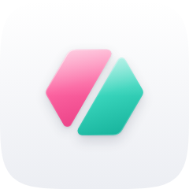

<p align="center">
  
</p>

<h1 align="center">Syntaxer</h1>

<p align="center">
  Generate consistent <strong>code syntax</strong> for your Figma variables — for Web, Android and iOS — in one click.
</p>

---

Figma lets every variable carry a *code syntax*: the name developers see and copy in Dev Mode (for example `var(--color-background-primary)` on Web or `colorBackgroundPrimary` on Android). Filling it in by hand for hundreds of tokens is slow and error-prone. Syntaxer builds it from your variable paths using the naming convention you choose, shows you a live preview, and writes it to the platforms you select.

> Syntaxer never renames your variables. It only sets or clears their code syntax.

## Features

- **Presets** for CSS variables, SCSS, Less, Tailwind CSS, Android and iOS.
- **Naming conventions**: kebab-case, camelCase, PascalCase, snake_case, SCREAMING_SNAKE_CASE, dot.case, path/case, Train-Case, lowercase, UPPERCASE, plus Android and Tailwind rules.
- **Prefix, separator and suffix** to wrap names (`var(--…)`, `$…`, `@…`).
- **camelCase aware**: `fontFamily` becomes `font-family`, or keep the original casing if your codebase uses it.
- **Name structure**: levels are detected from your deepest variable path. Drop or reorder any level.
- **Word replacements** such as `background → bg`.
- **Per-platform output**: write to Web, Android and/or iOS.
- **Collection and group selection** with a live preview before anything is written.
- **Native Figma UI** (UI3) that follows the light and dark themes, built with [FigUI3](https://github.com/rogie/figui3). Fully keyboard operable.

## Usage

1. Open **Plugins → Syntaxer** in a file that has local variables.
2. Pick a **Preset**, then fine-tune the **Naming** convention, prefix, separator and suffix.
3. In **Name structure**, uncheck levels you don't want and reorder the rest.
4. Add **Word replacements** if you need short forms.
5. Select the **Platforms** to write to.
6. Check the **Variables** (collections or individual groups) to update and review the **Preview**.
7. Click **Apply syntax**. Use **Clear syntax** to remove it from the same selection.

### Presets

| Preset | Naming | Example output for `color/background/primary` |
| --- | --- | --- |
| CSS variables | kebab-case | `var(--color-background-primary)` |
| SCSS / Sass | kebab-case | `$color-background-primary` |
| Less | kebab-case | `@color-background-primary` |
| Tailwind CSS | Tailwind rules | `bg-primary` |
| Android | camelCase, or snake_case for scales (spacing, radius, size…) | `colorBackgroundPrimary` |
| iOS (Swift) | PascalCase | `ColorBackgroundPrimary` |

Every preset only fills in the form: you can change any field afterwards.

### Name structure

A variable path such as `brand/color/surface/button/primary/hover` has six levels. Syntaxer detects the deepest path in the file and lists **Level 1 … Level N**, each with an example segment so you can recognise it. Variables with fewer levels simply skip the missing ones.

| Levels | Result (kebab-case) |
| --- | --- |
| All levels in order | `brand-color-surface-button-primary-hover` |
| Level 1 unchecked | `color-surface-button-primary-hover` |
| Level 6 moved to the top | `hover-brand-color-surface-button-primary` |

## Development

### Requirements

- Node.js `^20.19.0` or `>=22.12.0`
- Figma desktop app (needed to import a plugin in development)

### Setup

```bash
npm install
npm run build
```

Then in Figma: **Plugins → Development → Import plugin from manifest…** and select `manifest.json`. Run `npm run build` again after every change (or `npm run watch` for the plugin code).

### Scripts

| Script | What it does |
| --- | --- |
| `npm run build` | Compiles the plugin code (`code.ts` → `code.js`) and the UI (`ui/` → `dist/ui.html`). |
| `npm run build:code` | Compiles only the plugin code with TypeScript. |
| `npm run build:ui` | Bundles the UI into a single HTML file with Vite. |
| `npm run watch` | Recompiles the plugin code on change. |
| `npm test` | Runs the plugin logic against a mock of the Figma API. |
| `npm run lint` / `lint:fix` | Lints the plugin code and the UI. |
| `npm run clean` | Removes the build output. |
| `npm run icons` | Regenerates `ui/icons.js` from the official Figma icons. |
| `npm run assets` | Renders the Community icon, cover and carousel into `publishing/` (needs Google Chrome and internet for web fonts). |
| `npm run release` | Clean build, lint, tests and the pre-publish checks in `scripts/check-release.mjs`. |

### Project structure

```text
.
├── code.ts                  Plugin logic (runs in Figma's sandbox)
├── ui/
│   ├── index.html           UI markup (FigUI3 web components)
│   ├── main.js              UI state and messaging
│   ├── styles.css           Layout using Figma color tokens only
│   └── icons.js             Generated SVG icons (do not edit)
├── scripts/
│   ├── extract-icons.mjs    Builds ui/icons.js
│   ├── render-assets.mjs    Builds the Community listing images
│   └── check-release.mjs    Pre-publish checks
├── tests/plugin.test.mjs    Plugin tests with a mocked Figma API
├── publishing/              Community listing images, copy and checklist
├── vite.config.mjs          Single-file build → dist/ui.html
├── manifest.json            Figma plugin manifest
└── assets/                  Logo and other static assets
```

`code.js` and `dist/` are build output and are not committed.

### How the UI talks to the plugin

The UI owns the form state and sends it to the plugin, which computes names and writes them.

| Direction | Message | Payload |
| --- | --- | --- |
| UI → plugin | `init` | — |
| UI → plugin | `update-settings` | `{ state }` — levels, platforms, collections, replacements, settings, preview filter |
| UI → plugin | `apply-preset` | `{ preset }` |
| UI → plugin | `apply-changes` / `clear-syntax` | — |
| UI → plugin | `close` | — (handled, not sent by the current UI) |
| plugin → UI | `collections-loaded` | `{ collections, error? }` |
| plugin → UI | `preview-updated` | `{ variables }` |
| plugin → UI | `preset-applied` | `{ settings }` |
| plugin → UI | `changes-applied` / `syntax-cleared` | `{ ok, count, error? }` — always sent, even on failure |

### Notes

- The UI is fully offline: everything is bundled into `dist/ui.html` and the manifest allows no network access.
- Colors come exclusively from Figma's `--figma-color-*` tokens. The one exception, `--figma-color-bg-menu`, works around a FigUI3 fallback that renders light-theme menus white on white.

## Publishing

Run `npm run release`, test the plugin in the Figma desktop app, and publish from **Plugins → Manage plugins**. [publishing/LISTING.md](publishing/LISTING.md) has the full checklist, the listing copy, the images and the data security answers.

## Changelog

See [CHANGELOG.md](CHANGELOG.md).

## Third-party licenses

Syntaxer's UI uses [FigUI3](https://github.com/rogie/figui3) by Rogie King, which is split-licensed: the core (`fig.js`, `fig.css`) is MIT, and the editor module (`fig-editor.js`, `fig-editor.css`, which provides `fig-select` and `fig-reorder`) is licensed under PolyForm Shield 1.0.0. The drag-handle icon comes from [`@create-figma-plugin/ui`](https://github.com/yuanqing/create-figma-plugin) (MIT).

## Contributing

Issues and pull requests are welcome. Before opening a pull request, make sure `npm run build`, `npm run lint` and `npm test` pass.
