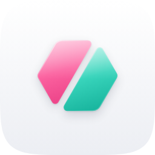

# Syntaxer logo

  

**Split token**: a Figma variable hexagon cut by a slash into a `<` and a `>`. The hexagon is the variable, the slash is the path separator (`color/background/primary`), and the two halves are code. Pink is the design side, teal the code side, and the gap between them is what Syntaxer does.

The identity has two layers:

- **Flat masters** (`svg/`): the brand source. Use them for lockups, one-colour work, print and anything 32 px or smaller.
- **Glass icon** (`svg/syntaxer-icon-glass-*.svg`, `png/`): the Liquid Glass expression: a squircle tile, two glass slabs, one fine specular edge and soft neutral shadows. Use it wherever Syntaxer appears as an app: the Figma Community icon, README, social avatars.

## Files

| Folder | Contents |
| --- | --- |
| `svg/` | Symbol, wordmark, horizontal and stacked lockups in `color`, `color-on-dark`, `night`, `black` and `white`; flat icon and small icon (light and `-dark`); glass icon in `light` (default), `dark` and `clear` |
| `png/` | Glass icon 128–1024 px, flat icon, symbols, lockups |
| `web/` | `favicon.ico` (16/32/48), `favicon.svg`, `favicon-16/32.png`, `apple-touch-icon.png` |
| `icon-composer/` | Unmasked background and one flat layer per half, ready for Apple's Icon Composer, which adds real Liquid Glass |
| `presentation/` | Identity presentation (`syntaxer-logo.html`) and slides as PNG |

## Colour

| Name | HEX | RGB | Use |
| --- | --- | --- | --- |
| Syntaxer Pink | `#FF4F9A` | 255 79 154 | Left half on dark backgrounds |
| Pink Deep | `#E8357F` | 232 53 127 | Left half on light backgrounds |
| Syntaxer Teal | `#1FD1B5` | 31 209 181 | Right half on dark backgrounds |
| Teal Deep | `#0B9C85` | 11 156 133 | Right half on light backgrounds |
| Night | `#17132A` | 23 19 42 | Icon tile, wordmark, one-colour logo |

On light backgrounds use the `color` files (deep tones, Night wordmark). On dark backgrounds use `color-on-dark` (bright tones, white wordmark). For one colour use `night`, `black` or `white`.

## Lockups

- **Horizontal** (`syntaxer-horizontal-*`): default. The symbol is 1.7× the wordmark's x-height and is centred on it; the gap is about half an x-height.
- **Stacked** (`syntaxer-stacked-*`): square-ish spaces such as avatars with text, stickers and slides.
- **Symbol** or **icon** alone when the name is already shown nearby (plugin menus, tabs).

Don't redraw the wordmark with a font. It is custom: the `x` reuses the symbol's slash cut and the `y` the same 60° angle.

## Clear space and minimum size

- Clear space around any lockup: one x-height of the wordmark (the height of the `n`) on every side.
- Clear space around the symbol: a quarter of its width.
- Horizontal lockup: 96 px wide minimum on screen. Symbol: 16 px.
- At 32 px and below, use `syntaxer-icon-small.svg` or `syntaxer-symbol-small-*.svg`. They have a wider slash so the gap doesn't close. Glass effects don't read at that size, so the small icon is flat.

## Glass icon

The icon follows Apple's current icon language: restraint first, colour in the glass, the system's own shape.

- **Tile**: a continuous-curvature squircle (superellipse) with a quiet neutral gradient. The default appearance is light; `dark` uses a neutral near-black and `clear` is colourless frosted glass.
- **Glass**: each half is a slab with a top-lit gradient, a soft sheen on its upper half and a single fine specular edge, brightest at the top left. The teal slab sits slightly in front, so its shadow is a touch longer.
- **No glow, bevels or dark rims.** Depth comes only from light and short neutral shadows.
- At 32 px and below, use the flat `syntaxer-icon-small*.svg`. Glass detail doesn't survive that size.
- The glass files use gradients and blur filters. Use the PNGs anywhere SVG filters aren't supported.
- For a native Apple icon, import `icon-composer/` into Icon Composer and let the system render the Liquid Glass instead of these static effects.

## Don't

- Don't rotate, mirror or re-angle the slash. It is always 60°, rising to the right.
- Don't close the gap, swap the colours between the halves or add a third colour.
- Don't add outlines, glows or drop shadows to the flat logo, and don't add glow to the glass icon. Depth belongs to the glass icon's light and shadow only.
- Don't put the `color` version on dark backgrounds or `color-on-dark` on light ones.
- Don't place the logo on busy images without a Night or white backing.

## Source

The masters are generated geometry: a regular hexagon (R = 112 on a 256 canvas) split along a 60° line through its centre, with an 18-unit gap, 18-unit corner radii, sharper 8-unit points and 7-unit cut corners. The small cut uses a 30-unit gap.
